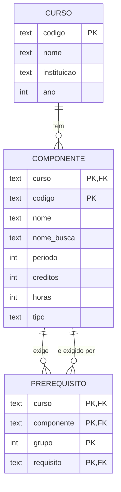
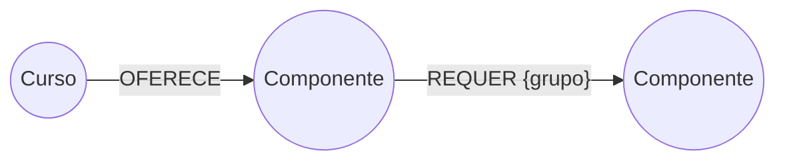

# Modelos lógicos

Domínio: um **curso** tem **componentes curriculares** (disciplinas, optativas, atividades). Cada componente pertence a um período e pode ter **pré-requisitos**.

Regra dos pré-requisitos (legenda do fluxograma do SIGAA): setas contínuas são **E**, tracejadas são **OU**.
Isso vira uma lista de grupos: os **grupos são ligados por E** e os **itens de um grupo por OU**.

```
Arquitetura de Software (TAD0029): [["TAD0103", "TAD0111"]]            -> TAD0103 OU TAD0111
Projetos Aplicados I   (TAD0156): [["TAD0102"], ["TAD0012"], ["TAD0103"]] -> TAD0102 E TAD0012 E TAD0103
```

## a) Relacional (PostgreSQL)



- `PREREQUISITO` é a tabela associativa N:N de `COMPONENTE` com ela mesma.
- `grupo` guarda a lógica E/OU: mesma `grupo` = OU, `grupo`s diferentes = E.
- Pré-requisito transitivo: `WITH RECURSIVE`.

## b) Documentos (MongoDB)

Uma coleção `componentes`, um documento por componente, com os pré-requisitos **embutidos**:

```json
{
  "_id": "TADS-2019:TAD0029",
  "curso": "TADS-2019",
  "codigo": "TAD0029",
  "nome": "Arquitetura de Software",
  "nome_busca": "arquitetura de software",
  "periodo": 4, "creditos": 3, "horas": null, "tipo": "obrigatoria",
  "prerequisitos": [["TAD0103", "TAD0111"]],
  "prereq_flat": ["TAD0103", "TAD0111"]
}
```

Coleção `cursos`: `{ "_id": "TADS-2019", "nome": ..., "instituicao": ..., "ano": ... }`.

- `prerequisitos` já é a forma E/OU (lista de listas): lê-se o componente inteiro em um acesso só.
- `prereq_flat` é a mesma informação achatada e indexada (índice multikey) para as buscas "quem exige X" e para o `$graphLookup`.
- Pré-requisito transitivo: `$graphLookup`.

## c) Grafo (Neo4j)



- Nós: `(:Curso {codigo, nome, instituicao, ano})`, `(:Componente {uid, curso, codigo, nome, nome_busca, periodo, creditos, horas, tipo})`.
- Relações: `(:Curso)-[:OFERECE]->(:Componente)` e `(:Componente)-[:REQUER {grupo}]->(:Componente)`.
- Mesma `grupo` entre o mesmo par origem/grupo = OU; `grupo`s diferentes = E.
- Pré-requisito transitivo: `-[:REQUER*]->`.

Exemplo: `(TAD0029)-[:REQUER {grupo:0}]->(TAD0103)` e `(TAD0029)-[:REQUER {grupo:0}]->(TAD0111)`.
